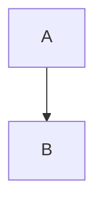

# Home heading

Exact-ish: [[Foo Example]] and [[FOO_example]].
Duplicate: [[Shared Name]] and [[Shared Name|the label]].
Qualified: [[Projects/Alpha/Shared Name]] and [[Beta/Shared Name]].
Dated: [[Daily]] and [[2024-03-05 Daily]].
Missing: [[Missing Page]].
Tags: #project/alpha #Status and not in code `#notatag`.
First line
second line

```rust
fn main() { println!("hi"); }
```



<div class="raw-html-check">raw <b>html</b></div>

- [ ] open task
- [x] done task
- [/] doing task
- [-] dropped task
